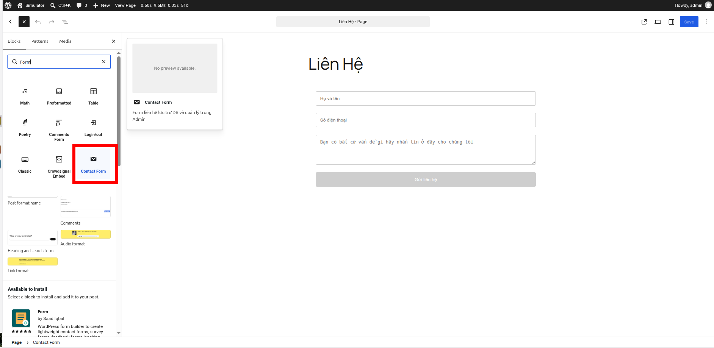
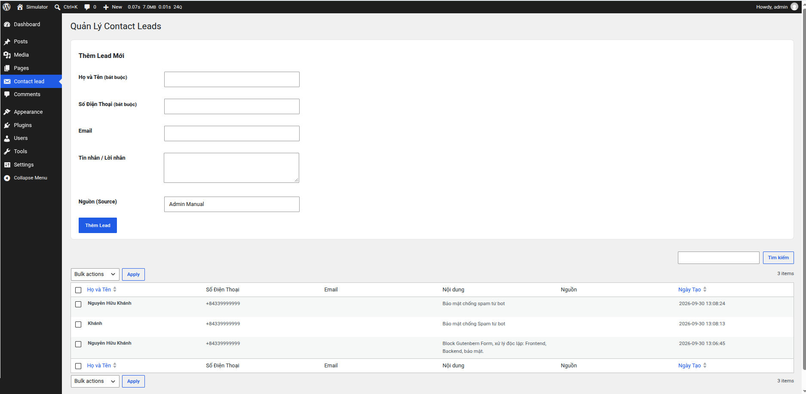
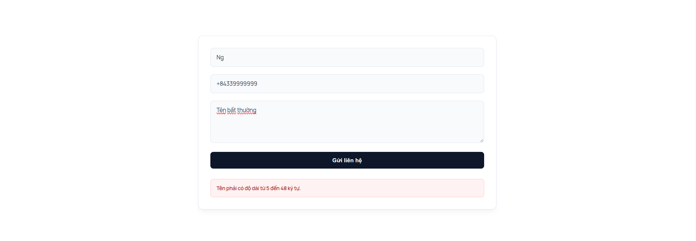
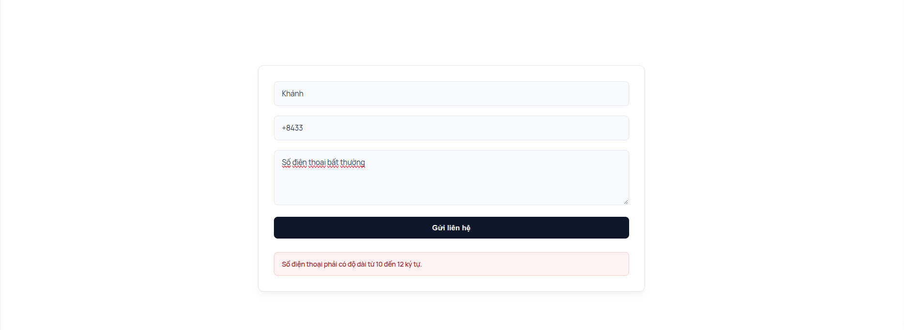
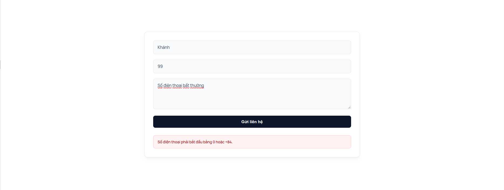
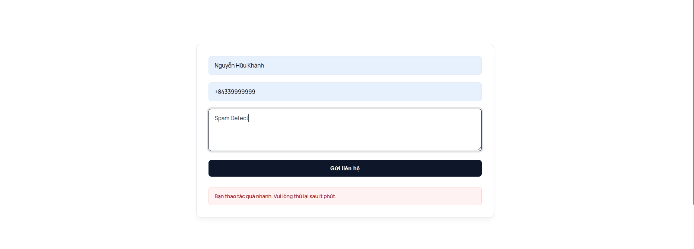
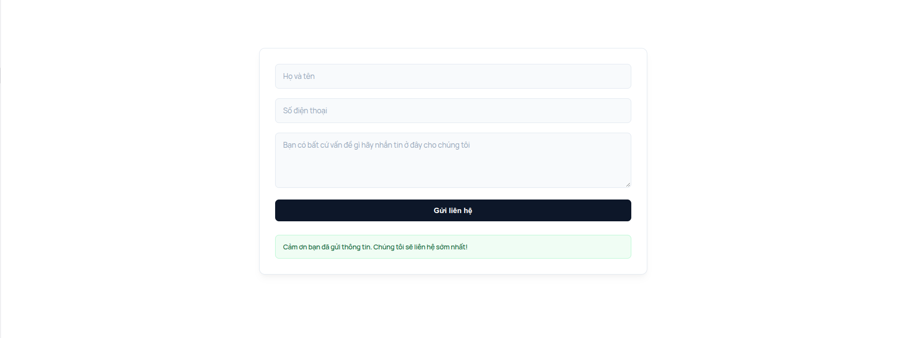
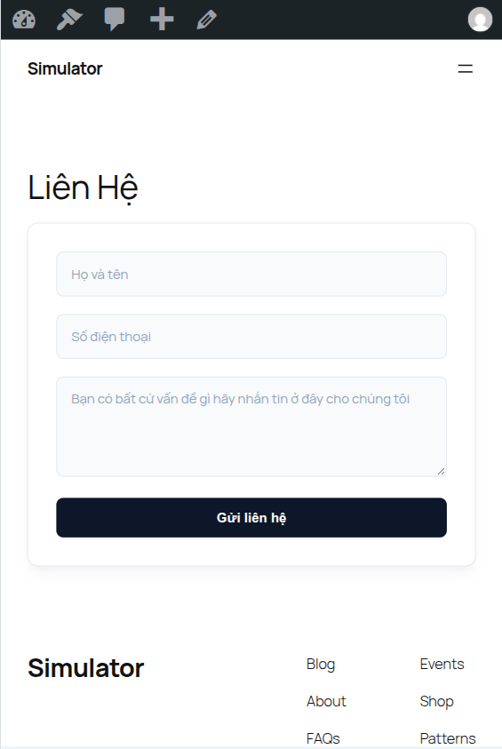

# Contat Form Block Gutenberg

A lightweight standalone contact form block for Kha Xuyen Computer websites.

## Requirements

* PHP: 8.1+
* WordPress: 7.0+

## Key Features

* Gutenberg Block: Easy drag-and-drop from insertion within the Gutenberg editor.
* Secure Data Handling: Input spam detect, honeypot, validate, sanitization.
* WordPress REST API Endpoints: Dedicated endpoints for seamless REST form submissions.
* Admin Dahboard: Admin Dashboard Panel same WordPress with remove, add new lead
* Database: Custom Table for data storage.
* Robust Architecture: OOP, Layer Architecture.

## Screenshots

### Gutenberg Block Editor

*Inserting and customizing the block within the WordPress Gutenberg editor.*

### Admin Management Panel

*Overview of the Admin panel showing stored entries and submissions.*

### Form Validation & Interactive Feedback




### Spam Detect

*Overview of the Admin panel showing stored entries and submissions.*
### Sucess form


## UI Reponsive



## Installation

1. Upload the plugin folder to your `/wp-content/plugins/` directory.
2. Activate the plugin in Admin WordPress (`/wp-admin/plugins.php`)

## Use

1. Open any Page or Post in the Gutenberg Editor.
2. Search for the custom block (Contact Form) and insert it into your layout.
3. Publish/Update the page.
4. Navigate to the plugin's Admin menu in the sidebar to review incoming form submissions.

## Architecture Overview

Architecture Overview

```text
src/
├── Admin.php        # Handles WP Admin UI and render dashboards
├── Api.php          # Registers REST API endpoints
├── ContactDTO.php   # Data Transfer Object for submission payload
├── Controller.php   # Directs application logic flow
├── Database.php     # Custom table schema and database operations
├── Enums/           # Strong-typed keys (Admin, DB, Form, REST)
├── Repository.php   # Database queries & data access layer
├── Sanitize.php     # Data cleansing helpers
├── Security.php     # Nonce & security checks
└── Validate.php     # Form field validation rules
```